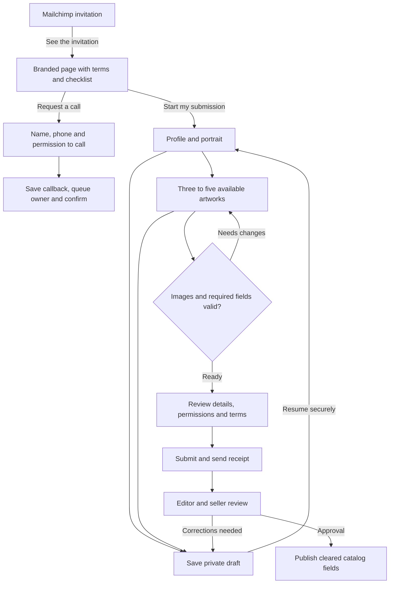

# Artist invitation and catalog intake

## Executive summary

The first campaign starts with 50 Taos artist prospects. Invite the permissioned audience to submit a profile and three to five available works. A single Mailchimp button takes artists to a branded invitation page. There they can read how the feature works, see the **20% commission on artwork sold through the platform**, and choose to submit their work or request a call.

Save each completed field and validated asset into a private canonical database as the artist works. The future website reads only approved, published fields from the same database. Automate saving, validation, receipts, routing and publication after approval. Editors approve bios, artwork, rights and publication. A named team member returns calls. The MVP1 catalog can still select ten artists per city from a larger intake pool.

## Implementation

The [artist webform repository](https://github.com/Suede0619/asw_artist_webform) implements this intake. React and Vite provide the interface. An Express service creates and migrates an embedded SQLite database and stores private originals and processed images on the same durable disk. No separate database service is needed for the pilot. Deploy a single service on a private persistent volume behind HTTPS. The future site reads the approved catalog feed. The application keeps sales and checkout outside intake.

Email verifies the artist’s address before they enter the profile form. Local preview writes private email files. Production uses a transactional SMTP sender. The reviewer enables publication after confirming permissions, credits, seller routing, price and availability. The current rollout supports JPEG, PNG and WebP. Convert HEIC to JPEG for this release.

## Journey

## Invitation page and form behavior

| Step | Presentation | Completion |
|---|---|---|
| 1. Invitation | Explain the art-first guide, the first edition, commission, materials and what happens after submission. Show **Start my submission** and a quieter **Request a call**. | Record the selected path. No form account is needed to read the invitation. |
| 2. Callback | Ask for name, phone, permission to call, and optional best time or question. | Store the request, display confirmation and assign it once to a monitored queue. A callback grants contact permission for this request. |
| 3. Artist profile | Collect email first for draft recovery. Show progress, labeled fields and the portrait upload. | A secure draft exists after the artist supplies contact information. Validated edits save promptly and show their save state. |
| 4. Work submissions | Use repeatable work cards with one image minimum. Show work count and a quick preview. | Between three and five complete, available works with valid images. The artist can add, remove, reorder and edit work cards. |
| 5. Review | Summarize what may appear publicly, what stays private and what the 20% covers. Let the artist correct each section. | Record acknowledgments and their version. Confirm the artist can submit each work and identify any representing gallery or rights restriction. |
| 6. Receipt and editorial review | Give a reference number and an email receipt. Let the artist report a sale, correction or withdrawal. | Queue for editorial review with status and owner. An approved catalog record appears only after the publication check. |

Mobile is the primary acceptance surface. Use an ordinary file-picker control, visible field labels, keyboard operation, inline errors and an error summary. Retain completed fields when an upload fails. Support a secure email resume link, expiry, reissue and progress through the draft. The submitting artist can review, reopen an authorized change request or withdraw. Define retention, deletion, backup and who can recover draft data before launch.

## Artist and artwork fields

| Record | Required for submission | Optional or conditional |
|---|---|---|
| Artist | Display name, private email, private phone, public locality and state, short bio, portrait, portrait credit and authority to share it. | Pronouns, website, public contact link, studio visit information if invited and verified. Collect any legal or payout identity later through the seller process. |
| Work | Title or explicit untitled label, short narrative, medium, height and width, depth when applicable, dimensions unit, price, currency, available status, one image, credit, rights declaration, and whether artist or gallery handles the sale. | Year, edition and edition size, framed size, installation notes, additional images, alt-text suggestion, pickup/shipping context, location of work and gallery contact where authorized. |
| Permissions | Submitter has authority to share the material for review. Capture the scope of any proposed public use and who can grant it. Record the artist’s acknowledgment of the commission disclosure. | Restrictions, expiration, credit requirements, approvals from galleries or photographers, and separately documented agreement to sell through the site. Marketing opt-in is separate and optional. |

Validate positive prices, allowed currency, units and required depth for three-dimensional work. Keep retail price, availability and last confirmation time on each record. An interested artist can submit without accepting live selling terms. A representing gallery or price conflict goes to review. Collect no payment or banking information in this form.

## Image requirements

Every image, including the portrait and any additional detail photos, must be **at least 1,080 pixels on the longest side**, measured from the decoded image after orientation. A 1,080 × 720 image qualifies. A 1,079 × 1,079 image does not. A browser check gives quick feedback, and server-side decoding enforces the requirement before acceptance. Never upscale a rejected file to make it qualify.

Support JPEG, PNG and WebP. Support HEIC on iPhone only if the server can decode, validate and create a preview reliably. If the format fails, explain how to upload a JPEG. Set a documented file limit and reject malformed content. Save originals in private object storage. Generate public derivatives with metadata stripped and orientation corrected. Keep the original credit and permissions with the asset record. Show progress, per-file retry and a thumbnail. Use authenticated or short-lived asset URLs for drafts. The public site serves only approved derivatives.

## Database, automation and review

| Data | Purpose | Access pattern |
|---|---|---|
| Application and profile versions | Draft ID, campaign, status, timestamp, private contact, profile fields and changes. | Artist with an expiring resume link and assigned staff. |
| Works and media | Linked work IDs, assets, availability, price, provenance, review status and publication fields. | Draft access for artist and staff. Website reads only approved versions and media. |
| Permissions and decisions | Permission type, scope, version, evidence, reviewer and time. | Staff record approval, restriction, change or withdrawal with an audit history. |
| Callback and notification queue | Contact request, assigned owner, status, receipt and retry record. | Staff queue and transactional delivery only. |
| Public catalog view | Current published profile, work and asset fields. | Read-only access from the future website. Exclude private email, phone, drafts, originals, internal notes and rights evidence. |

Save field updates as the artist progresses through an authenticated draft. Use a stable submission ID, idempotent save and final-submit operations, and version checks for concurrent edits. Show save failures and offer retry without clearing the form. Final submission checks the latest persisted fields and accepted uploads, records the submitted version, and enqueues a single receipt and review task. Give automated notifications a retry limit and a staff alert for repeated failures. An editor approves the public snapshot. A later correction creates a reviewed version. An urgent sale or withdrawal can suspend the public entry without deleting the private history.

Automated pipeline for launch. Form to canonical records and private object storage, then review queue, then approved publication state, then site read. The release needs a production-capable backend and access controls. The current static prototype can demonstrate the journey using fictional records. See the [technical specification](06-DATA-TECHNICAL-AND-CONTENT-SPEC.md) for the catalog integration boundary. Use Mailchimp for the permissioned invitation and audience preferences. Use transactional messages for draft links and receipts. Do not push contact details or uploaded assets into a public repository.

## Release acceptance

- A recipient can reach the branded HTTPS page from a Mailchimp test message, read the offer with images off, and choose either path.
- One callback submission creates one queue item. A repeated send or a refresh does not create a duplicate. The owner can acknowledge, complete or close it.
- An artist can complete the form on a phone, leave and resume from another device, replace one failed image and submit three to five works. A second submission click retains one application and one receipt.
- The database records submitted text, assets, commission acknowledgment and permissions against the correct profile and works. A reviewer can request one correction and then approve the new version.
- A public request cannot retrieve a draft, contact field, upload token, original media or unapproved work. A withdrawal or sold status updates public output. Track how long the update takes.
- An operator can review stuck uploads, unprocessed notifications and stale applications without needing a spreadsheet export. A tested backup restores required records and their media references.

## Commission and rollout

The campaign policy is **20% on completed artwork sales through ArtSouthwest**. This replaces the earlier zero-commission website assumption for this channel. The working basis is the artwork subtotal after approved discounts and refunds, excluding separately itemized tax and shipping. Confirm the basis, payment fees, applicable seller terms, payout, returns and any gallery split before selling. External purchases and referrals require any separate terms to be agreed. There is no submission fee. The form publishes a plain-language disclosure and records its version. This intake does not turn on checkout. See the [baseline](../PROJECT-BASELINE.md) and [commerce specification](05-COMMERCE-PRICING-AND-OPERATIONS.md).

1. **Test the experience.** Use three to five fictional works and a callback. Test iPhone, desktop and keyboard; resume a draft; reject a 1,079-pixel image; accept a 1,080-pixel image; and retry an interrupted upload and repeat submit.
2. **Prepare the pilot.** Assign the artist inbox, callback queue, editor and rights reviewer. Confirm terms, permissions, the test URL and a working unsubscribe footer. Seed the catalog with reviewed records only. Verify that private fields and images cannot appear in the public view.
3. **Send to the permissioned audience.** Use the public HTTPS form URL, a campaign-level source tag and documented subscription permission. Avoid placing a recipient’s email or phone in any URL. Use secure resume tokens only from the draft recovery channel. [Mailchimp permission guidance](https://mailchimp.com/help/the-importance-of-permission/).
4. **Measure the two conversions.** Track delivered invitations to unique form visits, then form visits to starts and callbacks. Track starts to completed submissions, valid asset count, callback follow-through and submission-to-approved-profile rate. Use aggregate counts where possible. Treat email opens as secondary and keep contact data out of analytics.
5. **Reuse the intake.** Add gallery and other city workflows after artist intake proves the review queue, permissions and catalog feed. Add live inventory or checkout through the [staged release roadmap](11-MVP-RELEASE-ROADMAP.md).

The catalog builder owns implementation and automated checks. The city lead owns the invitation relationship and approves the callback coverage. Editorial owns content and asset review, and the project lead owns the live release decision.
