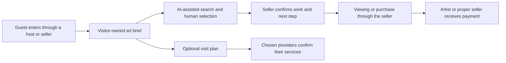

# A buyer-led art service for Taos

**October 25, 2026. Recommended pivot for discussion.** This responds to the concern that selling directory listings creates tedious sales work and little reason for established businesses to participate. It proposes a new service and test. It does not approve production, change prices, enroll partners or rewrite the financial models. Taos remains the first region. Regional shows and the Denver Energy Center proposal retain their own approvals and budgets.

## The recommendation

Start with a person who wants something: an artwork for a particular space, an introduction to an artist, or a rewarding art visit. Turn that request into a short, informed selection of actual work and a practical next step with its seller. Build the service around that request.

The proposed product is a **shared collector and visitor desk**. A guest can use it through a hotel's pre-arrival message, a gallery's existing website, a QR card, or a small mobile page. AI helps interpret the brief, search permissioned records, compare suitable choices and prepare the visit. Artists and galleries provide the work, judgment and seller confirmation. A funded service operator handles coordination.

The business sells completed service work and earns repeat use. Its central offer to a gallery is a relevant buyer request. Its offer to a hotel is a useful guest service. Its offer to an artist is a fair route to paid work. A website provides an interface, but joining a new directory is no longer the main ask.

The earlier plan already included a concierge and buyer briefs. The actual pivot is to make **the buyer's request the unit of the business**, price delivered service and distribute it through existing local relationships. This changes the work the business sells and the maintenance it asks of partners. It is more consequential than adding another AI chat window.

**Suggested visitor invitation:** “Find a piece you would love to live with. Tell us what draws you in, your budget and how you would like to see it.”

## A concrete experience

This is a fictional service scenario, not a booking, inventory claim or forecast.

1. A couple preparing for a Taos stay follows an optional link from their lodging host. They choose three images they like, describe the room where a work might live, and give an art budget. They can use words alone. A room photo is optional.
2. The service produces a concise brief they can edit: interests, dimensions, budget, visiting dates, preferred contact and permission to share with selected sellers. It asks whether either already works with a gallery or adviser.
3. A curator reviews three to five possible works from participating artists or galleries. Each result identifies the actual seller, medium, dimensions, asking price, source/check date and what remains unconfirmed. The service explains why each could fit. The buyer can reject a choice and say why.
4. The buyer selects a work and asks for a viewing. Only the selected seller receives the agreed information. The seller confirms availability and an appointment. Existing representation relationships remain intact.
5. The guest can add a nearby museum visit, a real workshop, dinner or lodging extension. Providers confirm their own services. The guest can keep an art-only shortlist and ignore travel suggestions.
6. The gallery or artist handles the sale through an agreed existing route. The service records an outcome only when a participant confirms it. Artist payments, seller balances, tax and shipping never become the platform's operating money.
7. With permission, the buyer keeps a personal collection/visit record and can request another introduction later. No one adds them to every partner's marketing list.

The memorable experience is discovering a real work and meeting its context. A chatbot conversation is a means of providing that experience.

## Three creative expressions of the same service

| Concept | Experience | Who gains value | First test |
|---|---|---|---|
| **Find my piece** | A buyer creates a visual or written brief and receives a small, reviewed selection with a viewing route. | Artists and galleries receive specific interests, budget and timing. Buyers receive useful judgment and confidence. | Five voluntary buyer briefs with three willing sellers and a funded curator. |
| **Art in your stay** | A lodging host offers a private pre-arrival art introduction. A guest can connect a stay to a gallery visit, artist appointment or commissioned work. | Lodging gains a distinct guest service. Sellers receive relevant visitors. Providers can receive chosen bookings. | One host offers the service to a small opt-in cohort. Measure staff work and actual referrals. |
| **Commission something that belongs here** | A visitor or local business describes a real need. The service prepares a paid commissioning brief and introduces suitable artists. | Artists receive paid creative work. Buyers obtain a structured process and appropriate introductions. | One funded brief. Pay substantial artist concept work. Confirm scope, rights and milestones privately. |

These are working descriptions, not cleared brands. Begin with **Find my piece**, distributed through **Art in your stay**. Add commissions after the team can manage artist selection, scope and delivery. A physical room exhibition, borrowed artwork or an artist supper needs its own permissions, insurance, labor and budget. Those are later experiments.

## The feature that changes the partner relationship

Let galleries respond to **qualified demand** without rebuilding a second catalog.

A consented request might say: “Original work for a 40-inch-wide space, budget supplied by the buyer, visiting next week, interested in seeing two or three works.” A participating gallery can reply with a few existing work links and a proposed next step. The operator prepares the comparison. The gallery confirms the record and availability before anyone receives a quote.

The first version can work through a small structured form and human-reviewed email drafts. A connected catalog is optional. Later, an approved feed or integration can reduce repeated work. The gallery's own inventory remains authoritative. Never claim an integration exists merely because another software vendor offers integrations in general.

An interactive “brief card” could let the visitor change a budget, reject a choice, add a reason, compare dimensions, request a human or decide who may see the request. The card would follow the visitor from a lodging link to an art selection and a confirmed introduction. A guest could complete it on a phone without downloading an app. An artist or gallery could respond using its current system. That is the first interface to prototype if the concept is selected.

The partner should see a request worth answering. If answering takes more effort than its likely value, improve qualification, reduce volume or stop sending requests. Do not send every brief to every seller. Do not sell a promised volume of leads before observing demand.

## Specific AI interactions

| Interaction | What AI can help with now | What must stay grounded |
|---|---|---|
| A visual taste conversation | Summarize what a visitor likes across approved images and ask useful follow-up questions. | Treat preferences as revisable. Do not infer wealth, identity or cultural affiliation from a photo. |
| Search a real set of work | Retrieve candidates using descriptions and explicit budget, size and medium filters. | Only approved records. Apply price and dimension limits in code. A human and seller verify suitability and availability. |
| Explain the selection | Compare verified facts and cite the source of each claim. | No invented artist intentions, provenance, authenticity, investment return or exhibition history. |
| See a work in a room | Help prepare a room view using the unaltered authorized artwork image, entered dimensions and a measured reference. | Accurate placement needs geometry and calibration. Label the view as a visualization. It cannot prove color, condition, fit or installation safety. |
| Coordinate a short visit | Draft a workable sequence around stated interests, access needs and published hours. | Real dates, travel and provider confirmation. No invented table, room or appointment availability. |
| Prepare a seller response | Convert a seller's approved links and facts into a clear shortlist or appointment proposal. | Seller approval before sharing. AI does not make offers or send messages by itself. |
| Keep records current | Flag inconsistent prices, missing dimensions, stale availability and broken source links. | An editor resolves conflicts. The system cannot silently overwrite the seller's information. |
| Carry the brief across surfaces | Reuse the visitor's chosen preferences through a hotel link, gallery page and saved personal plan. | Granular consent, limited data sharing and deletion controls. A shared brief is not a shared contact list. |

The current prototype has scripted assistance, demonstration checkout and researched candidates. It does **not** have these production integrations, cleared live inventory or a staffed collector desk. Present a new feature as proposed until it actually works.

## Value for every participant

| Participant | Useful result | Evidence to collect | Small first ask |
|---|---|---|---|
| Independent artist | Relevant viewing inquiries, completed paid sales or a funded commission. | Artist receipts, inquiry suitability, time spent and payment experience. | Approve a few work records or agree to respond to one suitable brief. |
| Gallery | A buyer brief that fits its program, with representation and seller control intact. | Accepted inquiries, appointments, completed sales and staff minutes per request. | Review one sample brief and identify what would make it useful. |
| Museum or arts organization | Better contextual visits and accurate, credited interpretation. | Consented referrals, visitor understanding and staff burden. | Check one draft contextual route. No endorsement or collection access implied. |
| Experience provider | A guest who understands the offering, practical needs and booking route. | Accepted bookings, cancellations and staff time. | Approve one accurate description and the direct next step. |
| Restaurant | A chosen dining inquiry connected to a feasible visit. | Provider-confirmed covers or private-event revenue, with clear attribution limits. | Agree whether this kind of guest request is useful. |
| Lodging | An art service that helps guests choose the property, enjoy a stay or return. | Opt-in use, staff time, guest feedback and attributable incremental bookings where measurable. | Offer the service to a small voluntary cohort. |
| Buyer | A suitable work, a trustworthy seller and a pleasant route to seeing or acquiring it. | Brief satisfaction, shortlist relevance, viewing completion and purchase experience. | Share a brief and permit one introduction. |

These are value hypotheses. No participant has agreed to them, and the project has not proved incremental revenue. A referral is not automatically a sale or a reason to charge.

## A bolder optional experiment: funded art credit

A lodging property or patron could fund a fixed art credit for a defined guest cohort. The credit would support a real purchase from an eligible artist or gallery. The sponsor would reimburse the agreed amount. The seller would not finance the promotion through an undisclosed discount.

This turns a small hospitality marketing budget into a measurable contribution toward artist income. It could make the guest experience more distinctive while giving a seller a funded reason to respond. The project would need written redemption, cancellation, refund, eligibility and accounting terms before offering it.

Credit funding is restricted money owed toward the purchase, not platform revenue. Do not promise the credit before funding it. Do not require public reviews, gallery visits or personal-data sharing to manufacture an endorsement. Begin without credits if no sponsor wants to underwrite them.

## How this could earn money

Keep zero platform commission on direct-artist website sales. The service needs a separate funded reason to exist.

| Revenue hypothesis | Who pays and what they receive | First proof |
|---|---|---|
| A lodging-supported collector desk | One or two hosts fund a defined number of guest-service briefs and response hours. They buy service capacity, not a higher search ranking. | A host agrees to a small funded test and receives useful delivery evidence. |
| Optional buyer service | A buyer pays an agreed fee for substantive curation, sourcing or coordination. Disclose the fee before work begins. | Buyers will pay for the specific work after seeing a sample output. |
| Business art brief | A hotel, restaurant, designer or workplace pays for a scoped sourcing/commissioning process. Artist concept work receives separate pay. | One accepted, funded brief with a clear decision maker. |
| Patron or sponsor underwriting | A supporter funds artist access, public discovery or service capacity with explicit rights and reporting. | The support fits the sponsor's actual purpose and has a real budget. |
| Provider referral income | A provider pays only under its actual approved referral arrangement and after the qualifying transaction. | Written terms, permitted attribution and real completed bookings. Assume zero before that. |

The earlier $150/$99/$199 profile proposals remain historical planning inputs. This recommendation removes selling profile slots from the leading pitch. It does not silently replace approved prices, because no production pricing or partner agreement exists.

### A small arithmetic test

This is a deliberately invented monthly test case, not a price recommendation, forecast or market quote.

Two hosts paying $750 each plus ten buyers paying $100 would produce **$2,500 service revenue**. Forty delivery hours costed at $40, $150 tools and $200 administration would cost **$1,950**, leaving **$550 before tax, reserves and any omitted costs**. Losing one host would produce a $200 deficit at the same cost. Doubling human delivery hours would produce a $1,050 deficit.

In that hypothetical scope, hosts fund the basic introduction service. A buyer fee would cover optional, separately defined additional work. Do not charge two parties for the same included deliverable without a clear agreement and disclosure. No one has accepted these prices or scopes.

Even if art sales were substantial, a zero art commission would contribute no art-sale revenue to these operating figures. Seller receipts are separate. This test would not establish enough income for two founders. Prove willingness to pay and delivery time before choosing a business model.

## A small test that could be delivered now

The schedule below is an optional sequence after the user approves the concept, a budget and an operator. It creates no appointments or deadlines.

1. **Problem check.** Speak with three gallery/artist representatives, two lodging hosts and five possible buyers who agree to a short conversation. Show a sample brief. Ask what is missing and what work participation would create.
2. **Permissioned sample.** Obtain a small approved set of actual work, or ask sellers to respond to individual briefs with their existing links. Record source, seller, rights, dimensions and freshness. Do not import unlicensed art or private inventory.
3. **Concierge rehearsal.** Process five voluntary briefs manually with AI-assisted drafting and human review. Confirm every introduction with buyer and seller. Use direct seller/provider routes. Accept no art payments through the prototype.
4. **A bounded paid test.** Proceed only if someone will fund the delivery. Agree scope, response windows, data handling, cancellation and what success would mean. Limit requests to the operator's capacity.
5. **Review actual outcomes.** Count received briefs, accepted introductions, confirmed viewings, seller-confirmed purchases, participant time, service revenue and costs. Record unknown outcomes as unknown. Avoid claiming causation when the buyer was already a gallery client.

**Suggested continuation criteria to agree before the test:** sellers judge the requests useful, buyers can identify why the shortlist helps, at least one real payer wants another funded round, records stay accurate, and delivery fits its funded labor allowance. These are proposed decision criteria, not proven thresholds. Stop or redesign if demand is weak, sellers do the same work twice, or the service depends on unagreed unpaid labor.

An outreach/curation operator must accept and have funding for the work. The digital builder is not automatically the sales representative, concierge, scheduler or event producer. A technically finished interface cannot substitute for that role.

## What makes the proposition different locally

Existing products already provide art inventory/CRM and gallery websites ([Artlogic](https://artlogic.net/about)), artwork room visualization ([ArtPlacer](https://help.artplacer.com/support/solutions/articles/65000185084)), hotel guest automation ([HiJiffy](https://www.hijiffy.com/)) and destination planning at the point of stay ([Mindtrip](https://resources.mindtrip.ai/business/insights/ai-at-the-point-of-stay)). These first-party pages describe product capabilities, not independently verified sales results.

The proposed distinction is a Taos service relationship: a buyer-owned brief, a small local seller network, relevant human judgment, existing seller systems, transparent introductions and measured artist receipts. The same brief can connect art and a visit without demanding five separate partner logins. That combination still needs validation. Do not claim a worldwide first or guaranteed advantage.

This is a credible way to ask established participants for their judgment. They can improve a useful service without being told that Taos needs rescuing or that their current work is obsolete. Their age, background and time in town do not predict whether they will support it.

The local evidence already includes art/hospitality collaboration at [Hotel Willa with The PASEO Project](https://www.hotelwilla.com/experiences/art-programs). The newly supplied [Art as Teacher case](../research/05-Art-as-Teacher-Foundation-2026-10-25.md) also shows experienced participants creating a new institution. Learn what these initiatives need. Do not pitch a claim that local people have failed to innovate.

## Pitch at an opening

Begin with the exhibition and the person. If they ask about the project:

> We're testing a small service that helps someone find art they actually want to live with, then connects them to the artist or gallery that has it. The seller keeps the relationship. We're trying to make the inquiry more useful without creating another catalog to maintain. Would that solve any problem you see, or miss the point?

Listen to the answer. A useful objection is information. If the person wants detail, ask whether they would prefer another time. Do not request a listing, an endorsement, a free consultation or a sale in the middle of someone else's opening.

The [Southwest Arts outreach package](../outreach/README.md) develops the audiences, timing and short pitches. The [AI and trust note](../outreach/05-AI-Trust-and-Environmental-Questions.md) addresses disclosure, environmental concerns and artist rights.
