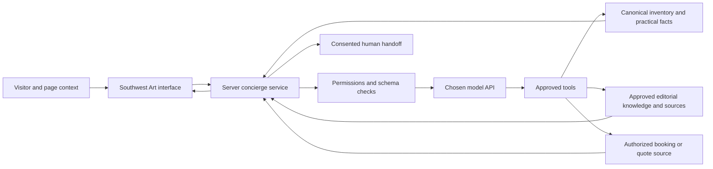

# AI concierge: service design, platform choice and evaluation

**Recommendation for review, October 19, 2026. The specification connects no model API or live chat.** Recheck model names, prices and availability before implementation. These engineering recommendations have no measured model comparison.

## One concierge across the website

Use one visible **Southwest Art concierge** throughout the site. Each section supplies different approved context, prompts and allowed tools. The visitor does not need to understand agent orchestration or repeat their brief to five disconnected bots.

| Page/mode | Helpful questions and actions | Data boundary / human handoff |
|---|---|---|
| Art discovery | Find work by price, dimensions, palette, medium, subject or artist. Explain terms. Compare verified options | Real inventory and approved context only. Hand off taste/representation questions. |
| Artist / work | Explain practice and process. Compare scale or editions. Prepare a viewing request or all-in quote | No invented intentions, authenticity, appraisal, investment return or discounts. |
| Galleries | Find a program, exhibition, location and appointment. Compare interests | Current approved gallery data. Paid status cannot silently determine recommendation. |
| Experiences | Find a suitable outing. Compare duration, cost, exertion and travel. Suggest a realistic plan | Published/provider data and approved booking routes. No invented access or live conditions. |
| Dining | Match cuisine, budget, location, service period and confirmed practical needs | Show the source-check dates for menus and hours. Allergies and reservations require provider confirmation. |
| Lodging | Compare known room/property attributes against dates, party and preferences | Rates/availability only from a live approved source or explicit quote. Otherwise “check with property.” |
| Your plan / collecting support | Carry selected works and visit choices together, prepare a concise brief and request human help | User-controlled memory and consent. Never sends an inquiry or books merely by drafting it. |

A later staff-only assistant can flag stale records, incomplete dimensions, duplicate works, missing rights and contradictory prices. Send proposed corrections to an editor for review before publication.

## The interface

Each section includes a small inline question field with three contextually useful starter prompts. A consistent header/dock opens the same conversation. Desktop can use a proposed 400–440px side panel. Mobile uses an accessible sheet with a clear close button, preserved scroll position and an unobstructed primary action. Do not auto-open or animate it over art.

The assistant returns compact explanations with actual work/venue cards rendered from database records. It offers **Apply these filters**, **Compare**, **Save to my plan**, **Request a viewing**, or **Speak to a person** as appropriate. A visible action or explicit natural-language instruction can change filters. Show the result and an undo. Financial or external communication actions require their own deliberate confirmation.

Label it as AI assistance in a restrained way and show factual sources/verification dates where useful. A status such as “I don't have a confirmed price for this work” is better than a polished invented answer. A service promise names staffed hours and response expectations. “Speak to a curator” requires an agreed, staffed human service.

## Recommendation: OpenAI Responses API, with a custom site interface

Use **OpenAI Responses API with `gpt-6.1-sol` as the initial production candidate**, subject to the task evaluation. It is the current balanced model in the official catalog, with text/image input, multilingual capability and tool support. Keep the interface ours, using the approved design system. Do not force an unrelated generic chat widget onto the site. [Official model catalog](https://developers.openai.com/api/docs/models).

Use structured tool calls for filters and record retrieval, and schema-controlled responses for actions/cards. Structured output makes parsing more dependable. It does **not** guarantee truthful facts or authorized actions. Backend validation remains essential. [Official structured-output guidance](https://developers.openai.com/api/docs/guides/structured-outputs).

### Alternatives to evaluate on the same tasks

| Platform / candidate | Documented fit | Proposed role / decision |
|---|---|---|
| OpenAI `gpt-6.1-sol` | Balanced model, multimodal input and tool-capable API | Default candidate for concise discovery, comparison and itinerary assistance. |
| OpenAI `gpt-6-luna` | High-volume/cost-sensitive model | Potential later routing or narrow extraction tasks after validation. Ordinary filtering does not need an LLM. |
| OpenAI `gpt-6-astra` | Highest-capability flagship in the current catalog | Optional complex assistance/escalation. No reason to pay flagship cost for every simple query. |
| Anthropic `claude-sonnet-5-5` | Official current model supports text/image input, multilingual interaction and tools | Serious challenger for tone, grounded answers and tool reliability. |
| Google `gemini-3.8-flash` | Current stable Flash model. Gemini supports function calling | Challenger for latency, multimodal workflows and operational fit. |

Sources: [OpenAI catalog](https://developers.openai.com/api/docs/models), [Claude models](https://platform.claude.com/docs/en/models/overview), [Gemini models](https://ai.google.dev/gemini-api/docs/models), [Gemini function calling](https://ai.google.dev/gemini-api/docs/function-calling). These vendor descriptions do not establish a universal winner. We have not benchmarked them with Southwest Art data.

Run a blinded task evaluation before freezing a model. Weight factual/tool correctness 40%, constraint-following 20%, helpful tone/clarity 15%, latency 15%, and operating cost 10%. A model that fails inventory or privacy requirements cannot win by scoring well elsewhere. Keep the provider behind a small adapter, but do not route one private conversation through several vendors by default.

## Data, editorial sources and model responsibilities

The model interprets language. Deterministic application tools search and sort. Relational fields enforce price, units, availability, seller and location. Semantic retrieval supports meaning and editorial context. Label general art-history answers separately from available inventory. A general knowledge answer must never become a claim that a historical artist's work is in our stock.

V1 needs no fine-tuning. High-quality records, concise approved content, good retrieval and evaluations matter more. Treat external web text as untrusted source material. Instructions inside it cannot change permissions or execute transactions. The public assistant cannot freely scrape arbitrary sites or browse private staff records.

## Proposed tool contracts

These endpoint requirements still need implementation.

| Tool | Input / result | Controls |
|---|---|---|
| `search_works` | Allowed filters/sort then known work IDs, factual fields, count, verification timestamps | Parameterized query, maximum page size, published records only. Unknown prices are not zero. |
| `get_work` | Canonical work ID then full approved record | No access by guessed private IDs. Inventory status checked. |
| `compare_works` | Up to four known IDs then normalized dimensions, price, medium and approved context | Display missing data. No fabricated comparison facts. |
| `search_places` | Region/type/date/practical needs then approved locations and events | Dates, timezone and expiry enforced. Access is not inferred. |
| `estimate_route` | Approved public stops and chosen origin then route estimate or no result | Real routing service or clearly labeled estimate. No private/sacred destinations. |
| `prepare_plan` | Selected records and preferences then editable plan | User reviews travel assumptions, hours and unresolved reservations. |
| `save_shortlist` | User-selected IDs then saved list | Anonymous/local first. Account/retention consent when needed. |
| `prepare_viewing_request` | Work, preferences, contact permission then draft request | Sending is a separate confirmed action with a responsible recipient. |
| `get_booking_link` | Experience ID then approved program/operator URL and disclosure | Correct affiliate ID, no invented attribution or modification of protected links. |
| `create_checkout_session` | Validated held order then hosted checkout URL | A trusted application action that follows the user’s deliberate purchase confirmation. |

The AI's return can reference only record IDs actually returned by permitted tools. Render price, availability, images and booking terms from server records. Check tool authorization for each user and session. Guests cannot read buyer records, artist payouts or unpublished material.

## Visual and multilingual capabilities

A visitor can optionally provide a room photo or describe a palette. Use the photo to clarify proportions and interests, then retrieve actual work. Infer no wealth or invented artwork. Build and label a visualization from genuine licensed artwork at known scale. Room images are private, optional and deleted on the agreed schedule. Propose a seven-day default for unfinished anonymous consultations.

English is the initial editorial language, with a clear path to Spanish and additional translated assistance. Curators approve key translated biographies, identity terms, policy and commerce copy. Translated conversation does not make every seller fluent in that language. Prices remain in actual transaction currency. Show the date and exchange-rate source for optional currency estimates.

Voice may help access later, but is not required for the first design prototype or v1 launch. Add voice only if user research justifies the privacy, consent, latency and environment costs.

## Cost, speed and reliability

As checked October 19, the OpenAI catalog lists `gpt-6.1-sol` at $2 input / $10 output per million tokens, and `gpt-6-astra` at $10 / $50. Recheck before budgeting. These rates cover model tokens only. Budget other service costs separately. [Official catalog](https://developers.openai.com/api/docs/models).

Cost calculation using the stated token assumptions: 5,000 input and 800 output tokens for one Sol turn cost **$0.018** under these assumptions. Eight such turns cost $0.144 per session. 3,000 sessions cost **$432** under these assumptions before tool usage, images, retrieval, hosting, logging, support and taxes. A proposed initial AI operating allowance is $500–$1,000/month, adjusted after observed usage, with spend caps and a graceful ordinary-search/human fallback.

Set a proposed simple-answer first useful response target under three seconds and a useful filter result under five seconds under documented conditions. Measure performance against the target. Stream concise progress only when helpful. Cache public retrieval, avoid needless tool chains, limit runaway turns, rate-limit abuse and preserve ordinary filters when the model is unavailable.

## Privacy and service boundaries

Minimize personal information in prompts. Use appropriate provider data controls, server-held credentials, access separation and explicit retention. OpenAI documents different endpoint/storage controls. Do not promise zero retention simply by omitting a database in our app. Review the actual configuration and any applicable eligibility. [Official data controls](https://developers.openai.com/api/docs/guides/your-data).

No automatic email/booking, sensitive profiling, private list exposure, authentication guarantees, investment advice, medical claims for a spa, or cultural identity inference. Real public safety/access questions go to current authoritative sources and the responsible provider. A fluent answer is not permission to visit a restricted site.

## Acceptance evaluation

Create 150 real task prompts before production: 40 art discovery/filtering, 25 object/artist questions, 20 experiences/routes, 15 galleries, 15 dining/lodging, 15 commerce/uncertainty, and 20 privacy/adversarial/misleading-source tests.

The evaluation must produce zero invented work IDs, prices or sale statuses. Check filters, undo, uncertainty, access controls and side effects. Answers must distinguish unique works from reproductions, cite dates and sources for local facts, and route unresolved requests to a person. Also measure tone, reading effort, latency, cost and successful next actions. Passing the evaluation set is one release condition. Continue checking actual answers after launch.

The prototype should simulate representative conversations and their UI changes for product and curatorial review of the experience without funding or connecting the live model yet. Clearly label simulated responses in the review build.
