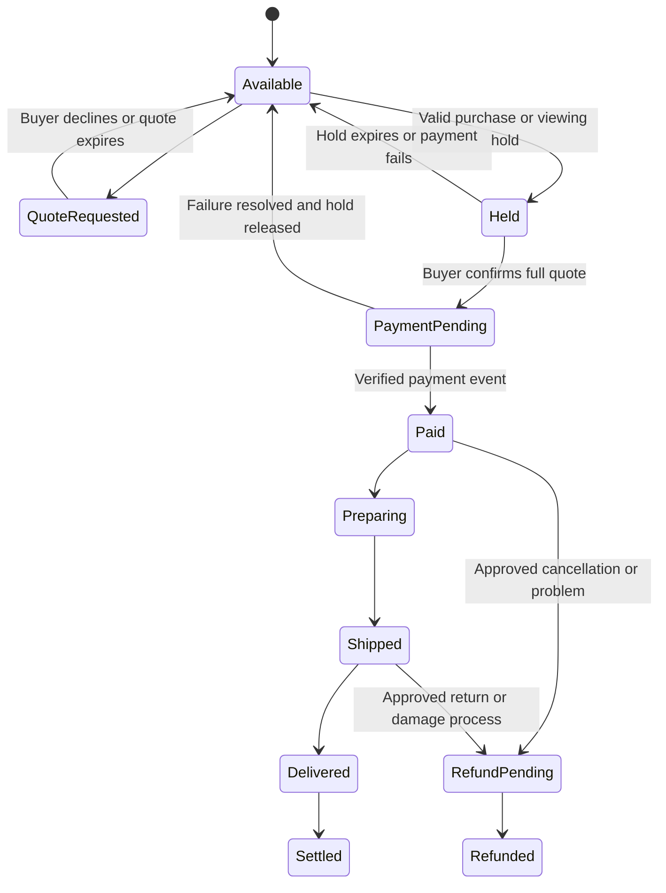

# Commerce, partner pricing and operational economics

**Proposal for review, October 19, 2026. No live Stripe or booking integration exists.** This is the website's commercial design, separate from the earlier festival financial model. The user now requires no Southwest Art commission on direct artist sales.

## 1. Artist payout and processing costs

Recommended mission policy: **the artist receives the agreed artwork subtotal. Southwest Art takes no art-sales commission and funds normal processor costs through its own operating/sponsor budget**. Itemize tax and agreed shipping or insurance, then route each amount to the responsible party. Returns/refunds and legitimate contractual obligations are not falsely described as permanent artist income.

If that fee subsidy is not funded, the truthful alternative is “No Southwest Art commission. Payment processing and other agreed costs apply.” Review that alternative commercially and curatorially before changing the artist promise. Do not display “100% to the artist” while subtracting ordinary processing costs from their payout.

This policy applies to **authorized direct-artist inventory**. A gallery seller may have a valid artist commission, estate ownership or resale arrangement. Those sales must name the actual seller and must not claim that all proceeds reach a living artist. Represented artists cannot use our site to evade an agreement. Resolve routing before publishing a buy action.

## 2. Stripe recommendation and demonstration scope

Use **Stripe Connect**, one onboarded seller per initial order, with hosted Checkout and signed webhook handling. The initial implementation candidate is **direct charges with the supported platform-paid fee configuration and zero application fee**, if the account/payment setup supports the agreed artist promise. Stripe's current guidance allows direct-charge fee-payer choices. Verify actual account settings and risk responsibilities before production. A destination-charge flow is an alternative if the operating model calls for it, but has different platform refund/dispute responsibility. [Stripe charge types](https://docs.stripe.com/connect/charges), [fee-payer behavior](https://docs.stripe.com/connect/direct-charges-fee-payer-behavior).

The artist's legal selling role, statement descriptor, tax responsibilities, fee liability and dispute responsibility must match the actual integration and agreement. A payment architecture choice does not by itself settle every legal/accounting issue. Use current Stripe onboarding and appropriate professional review for the final entity model.

For the prototype, every payment button leads to a **clearly labeled demonstration checkout**. No live keys, connected accounts, real money, actual purchase claim or real seller enrollment. Use explicit demo product IDs. Create real Stripe IDs only through the actual integration.

## 3. Purchase and delivery state machine

One unique work has one canonical inventory record and an atomic hold, even if several profiles display it. The proposed checkout hold lasts ten minutes. Show expiry and an accessible recovery route. Agree high-value viewing holds separately with the seller. Recheck availability before charging. Handle idempotency, duplicate/out-of-order webhooks, delayed payment methods, refunds and reconciliation deliberately. A success-page redirect alone does not prove payment.

Only verified price, approved terms and a complete delivery/tax treatment create a payable order. Request a quote when price is unknown. Quotes itemize art, approved discount, tax, packing, insurance, transport and installation. Do not silently copy another seller's shipping price or policy.

The seller/fulfillment lead supplies condition photos, packing plan, insured handling, tracking, delivery acceptance and a problem-resolution contact. Domestic supported routes can launch first, with international delivery by reviewed quote. Confirm title, export, destination tax, carrier coverage and cultural-property requirements before promising international delivery. Choose clear duties/import responsibility and disclose it before payment.

Stripe integration is not an escrow service by default. Do not hold artists' money as working capital or advertise escrow without an appropriate service and agreement. Distinguish a work sold from its payment, delivery and artist settlement status.

## 4. Experience referrals and fees

**Recommend no upfront charge for the core curated experience listing.** A selected museum, public walk or heritage visit should not disappear because it cannot or should not pay us. Earn from eligible commercial bookings where there is an actual agreement/program. Disclose referral income close to a booking action.

| Model | When to use | How money and tracking work | V1 recommendation |
|---|---|---|---|
| Official affiliate/referral link | Provider/activity is actually available through an approved program | Program-generated tracked link, eligible completed booking, program report/payout. No commission from clicks alone | **Default for suitable commercial experiences** |
| Direct provider referral agreement | Strong local operator outside an affiliate network | Written rate/basis, unique referral identifier or operator booking code, verified booking report, cancellation adjustments and monthly settlement | Good pilot with a few willing operators |
| Embedded provider checkout | Official licensed widget/API meets design/access needs | Booking stays with the actual provider/platform. Attribution under agreed terms | Consider after testing. Do not assume technical access |
| Southwest Art sells the activity | We intentionally accept seller/merchant/customer-service obligations | Contracted inventory, live availability, booking/order/payment/refund integration and supplier settlement | Later, only if commercial value justifies complexity |
| Paid experience sponsorship | An explicit advertising/service deliverable separate from curation | Clearly labeled fixed scope and price. No secret selection influence | Optional addition to the core listing |
| Free/noncommissionable visit | Public place or institution without an agreement | Honest information and official access route. Zero assumed commission | **Keep in the guide** |

Current primary examples: FareHarbor's FHDN markets **15% commission** on eligible participating experiences and automated payouts. Viator's affiliate program advertises **8% on completed bookings** with a **30-day referral window**. The providers publish these offers. Confirm the Taos activity’s participation and our account acceptance separately. [FareHarbor](https://fareharbor.com/scale/distribution-network/affiliates/), [Viator](https://partnerresources.viator.com/).

For a direct local agreement, test a **10–15% completed-booking referral fee**, with the exact percentage and gross/net basis negotiated. Do not stack an extra referral fee on top of an existing program fee without agreement. Explain who handles cancellations, weather, customer information and complaints. A UTM link alone does not create payment entitlement. It needs a contract/program and a completed-booking reporting mechanism.

Track an internal referral ID, program/provider, exact approved link, click time where consented, eligible booking reference, activity completion, refunds and payout. Do not claim perfect cross-device attribution. If the program withholds personal data, use its permitted reference or aggregate reports for reconciliation. Preserve required affiliate link parameters. Do not rewrite a protected program URL.

Never charge for public land access, resell Pueblo access or imply a special cultural arrangement without the responsible authority's agreement. A free self-guided walk can still contribute to a compelling visit and an art purchase.

## 5. Paid gallery, restaurant and lodging services

Proposed offer: a well-edited, approved profile, licensed images supplied/cleared by the partner, practical structured information, update support, a working inquiry/booking path, relevant concierge retrieval, and aggregate reporting. Quote photography, extensive video, custom writing and private events separately. The basic fee cannot silently include unlimited production labor.

| Category | Founding monthly proposal | Standard monthly test after proof | What a partner is paying for |
|---|---:|---:|---|
| Gallery | **$150** | $250 | Enhanced profile, approved artist/show data, appointment routing, inventory/availability administration within an agreed cap, reporting |
| Restaurant | **$99** | $149 | Edited profile, current menu/reservation links, practical metadata, correction support and referrals/reporting |
| Lodging | **$199** | $299 | Property profile, room-type/amenity data, date-aware referral route, concierge match and reporting |

These proposed prices need customer tests and signed policies. Keep commercial benefits separate from editorial selection and disclose paid profiles. Promise no traffic, bookings or sales without supporting evidence.

Start month-to-month, with a written founding term and cancellation rule. Bill only after the contracted profile/service is live and approved. An annual plan may charge ten months for twelve. Account for future service obligations before recognizing profit. Avoid charging a substantial setup fee before we can demonstrate value. Quote substantial content-production work separately.

Founding proof should include correct content, functioning inquiries and a clear report of useful activity. Test whether a modest-traffic profile produces enough relevant prospects to justify its price. After 90 days, review willingness to pay, service workload, inquiry quality, renewals and partner economics.

## 6. The economics of an artist-first website

At the full target cohort, twelve galleries × $150 + eight restaurants × $99 + eight lodging partners × $199 = **$4,184/month**, or **$50,208 annualized before discounts, churn, tax and operating costs**. Six paid months on average would produce **$25,104** in year-one profile revenue.

A literal full-art-price payout creates a real cost: at an **3% processing assumption**, $1m art value implies $30,000 in modeled fees and $3m implies $90,000. The calculation uses a 3% cost assumption. It quotes no Stripe rate. Processing on tax/shipping, international cards, currency conversion, Connect fees, refunds and disputes can change it. Fund the fee policy before promising large transaction volume.

Monthly operating scenario:

| Item | Assumption | Amount |
|---|---|---:|
| Founding profiles, all target partners active | 12 galleries + 8 restaurants + 8 lodging | $4,184 income |
| Direct experience referrals | 150 completed bookings × $200 eligible value × 12% negotiated rate | $3,600 income |
| Lean paid operating service | Editorial, concierge, content/admin, infrastructure and support envelope | $8,000 expense |
| Artist processing subsidy | $100,000 art value × model 3% | $3,000 expense |
| **Result before exceptional costs and tax** | All assumptions require validation | **−$3,216/month** |

This example deliberately exposes the gap. Paid listings alone are not an adequate financial plan for an impeccable service and fully subsidized artist payments. Options include mission-aligned sponsorship, patron underwriting, additional paid commercial services with genuine value, a higher validated partner price, more profitable referrals, or a smaller funded service. Do not quietly fill the gap with an artist commission contrary to the user's direction.

A prototype/build budget and a monthly service budget are separate. Proposed planning envelopes, pending actual quotes and chosen scope: design/interaction prototype **$3,000–$8,000 equivalent effort**, production v1 **$35,000–$75,000**, and a paid continuing service **$6,000–$12,000/month before art-processing subsidies and significant marketing**. Founder implementation can alter cash costs but should not make labor disappear from the business case. These cost assumptions need vendor quotes.

## 7. Operations, agreements and mission reporting

Before production, identify the legal operator and seller for each transaction type. Agree permissions, fees, taxes, delivery, refunds, risk, data, image licenses and paid partner terms. The festival nonprofit and a separate guide need a deliberate relationship. Do not allocate charitable funding to a commercial site without a valid, reviewed arrangement.

Use private order and settlement records, dual control for material payments and an itemized seller statement. Public reports show aggregate completed art value, artist proceeds actually paid, median artist outcomes, share of artists with a sale and payout timing. Partner invoices, experience commissions and donations are operating income. They are not art sales. A pledged sponsor or signed commission is not cash collected or a completed artwork sale.

Tax treatment, sales-tax/GRT/marketplace duties, charitable recognition and international consumer obligations require review for the actual arrangement. The earlier [operations guidance](../planning/05-Festival-Operations-Artist-Equity-and-Governance.md) supplies relevant primary sources and questions. It is not approval of this website's final structure.

## Commercial decisions for review

Confirm whether literal full-art-price payout with platform-funded fees is the policy. Identify its funding source. Review the three partner prices and service scope. Choose the initial affiliate or direct-referral approach. Confirm who will deliver concierge, content and settlement work. These decisions precede real checkout, partner billing or public claims.
